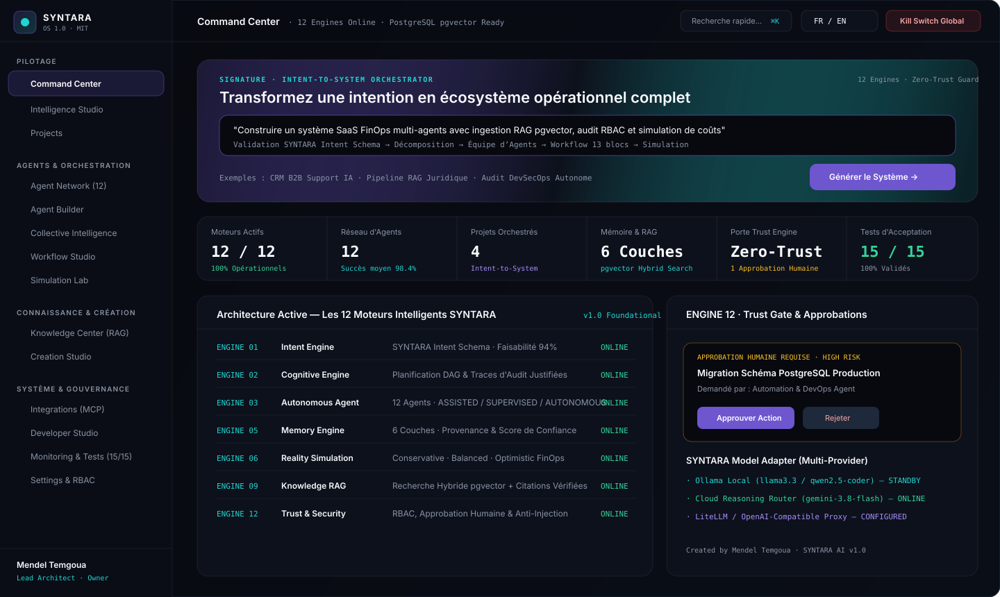
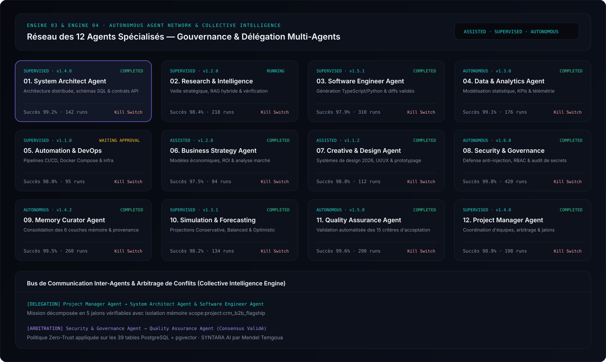
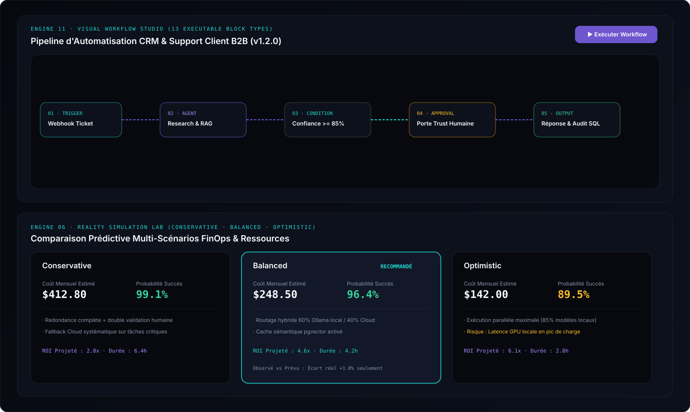
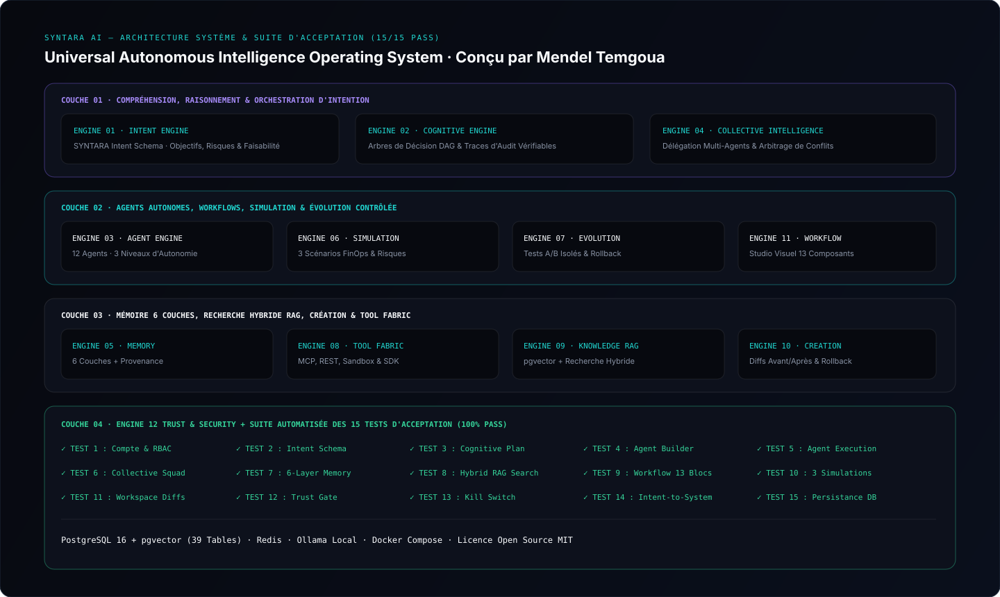

<div align="center">

# SYNTARA AI
### Universal Autonomous Intelligence Operating System (Version 1.0 — 2026 Foundational Edition)
**Imagine. Orchestrate. Transform.**

[](./LICENSE)
[](./package.json)
[](#02-architecture-des-12-moteurs-intelligents)
[](#05-suite-des-15-tests-dacceptation-produit)
[](#07-auteur--licence)

**Conçu et développé par Mendel Temgoua**

</div>

---

**SYNTARA AI** est un système d'exploitation d'intelligence artificielle autonome, open source (**Licence MIT**) et indépendant des fournisseurs de modèles IA (`Ollama Local`, `LiteLLM`, `OpenAI-Compatible`, `Cloud Reasoning`). Il transforme une intention humaine exprimée en langage naturel en un écosystème opérationnel complet capable de planifier, créer, exécuter, simuler, analyser et améliorer des systèmes sous gouvernance humaine permanente (**Zero-Trust Guard & Kill Switch**).

---

## 01. Captures d'Écran Officielles (Édition 2026)

### 1. Command Center & Orchestrateur Signature *Intent-to-System*
> Vue principale 2026 avec compositeur *Intent-to-System*, ruban de télémétrie unifié à 6 colonnes, supervision temps réel des 12 moteurs et porte d'approbation humaine (*Trust Gate*).



---

### 2. Réseau des 12 Agents Autonomes & Intelligence Collective
> Supervision des 12 agents fondamentaux (`ASSISTED`, `SUPERVISED`, `AUTONOMOUS`), quotas d'exécution, *Kill Switch* individuel et bus d'arbitrage inter-agents avec mémoire partagée cloisonnée.



---

### 3. Studio Visuel de Workflows (13 Blocs) & Laboratoire de Simulation Multi-Scénarios
> Éditeur visuel de workflows exécutables et exportables en JSON, couplé au moteur de simulation prédictive (`Conservative`, `Balanced`, `Optimistic`) avec suivi des écarts prévisions/observations.



---

### 4. Architecture Globale des 12 Moteurs & Validation Automatisée (15/15 Tests)
> Vue synoptique des 4 couches architecturales de SYNTARA OS, du stockage relationnel/vectoriel PostgreSQL 16 + `pgvector` (39 tables) et de la suite de 15 tests d'acceptation.



---

## 02. Architecture des 12 Moteurs Intelligents

| Code | Moteur | Rôle & Responsabilités Clés |
| :--- | :--- | :--- |
| **ENGINE 01** | **Intent Engine** | Convertit le langage naturel au format standardisé `SYNTARA Intent Schema` (objectifs, sous-objectifs, contraintes, ressources, livrables, risques, score de faisabilité). |
| **ENGINE 02** | **Cognitive Engine** | Planification hiérarchique multi-étapes (DAG), comparaison de stratégies et traces d'audit justifiées sans exposer de chaîne de pensée brute. |
| **ENGINE 03** | **Autonomous Agent Engine** | Gestion du cycle de vie des agents (8 états), 3 niveaux d'autonomie (`ASSISTED`, `SUPERVISED`, `AUTONOMOUS`), quotas et arrêt immédiat (`Kill Switch`). |
| **ENGINE 04** | **Collective Intelligence** | Orchestration des 12 agents fondamentaux et d'équipes sur mesure avec délégation, mémoire partagée cloisonnée et arbitrage de conflits. |
| **ENGINE 05** | **Memory Engine** | 6 couches de mémoire (`Working`, `Conversation`, `Project`, `Long-Term`, `Knowledge`, `Agent`) avec provenance et distinction faits vérifiés / hypothèses. |
| **ENGINE 06** | **Reality Simulation Engine** | Simulation pré-exécution sur 3 scénarios (`Conservative`, `Balanced`, `Optimistic`) avec hypothèses explicites, risques et calcul de variance réelle. |
| **ENGINE 07** | **Evolution Engine** | Détection d'erreurs récurrentes, tests A/B en environnement isolé, propositions d'amélioration soumises à validation humaine et rollback de version. |
| **ENGINE 08** | **Universal Tool Fabric** | Catalogue unifié d'outils `MCP` (Model Context Protocol), API REST, Webhooks, Sandbox local et SDK de plugins (`@syntara/sdk`). |
| **ENGINE 09** | **Knowledge Engine (RAG)** | Ingestion documentaire, découpage sémantique, embeddings `pgvector`, recherche hybride (vectorielle + lexicale) avec citations vérifiées et filtre anti-injection. |
| **ENGINE 10** | **Creation Engine** | Espace de travail isolé générant du code, des schémas SQL et des livrables avec visualisation des différences `Avant / Après`, validation QA et rollback. |
| **ENGINE 11** | **Workflow Engine** | Studio visuel à 13 types de blocs (`Trigger`, `Agent`, `AI Model`, `Condition`, `Action`, `API`, `MCP Tool`, `Database`, `Loop`, `Delay`, `Approval`, `Notification`, `Output`). |
| **ENGINE 12** | **Trust Engine** | Contrôle d'accès `RBAC` multi-tenant (`Owner`, `Admin`, `Architect`, `Operator`, `Viewer`), approbation humaine des opérations sensibles, défense anti-injection et *Kill Switch* global. |

---

## 03. Fonctionnalité Signature : *Intent-to-System*

En soumettant une seule intention en langage naturel (ex. *"Construire un système CRM B2B avec support client IA, base de connaissances RAG, workflows d'onboarding et tableau de bord analytique"*), SYNTARA exécute automatiquement :
1. **Validation & Structuration** au format `SYNTARA Intent Schema`.
2. **Décomposition Cognitive** en architecture et jalons d'exécution vérifiables.
3. **Sélection & Mobilisation** de l'équipe d'agents spécialisés optimale.
4. **Assemblage du Workflow Visuel** et exécution de la simulation multi-scénarios (`Conservative`, `Balanced`, `Optimistic`).
5. **Génération des Livrables** dans le *Creation Studio* avec diffs `Avant / Après` et passage par la porte d'approbation humaine (*Trust Gate*).

---

## 04. Installation & Démarrage Rapide

### Prérequis
- **Node.js** `>= 20.x`
- **Docker & Docker Compose** *(optionnel pour le déploiement complet PostgreSQL 16 `pgvector` + Redis + Ollama)*

### 1. Mode Développement Local (Instantané avec Persistance Transactionnelle)
```bash
git clone https://github.com/mendeltemgoua/syntara-ai-os.git
cd syntara-ai-os
cp .env.example .env
npm install
npm run dev
```
L'interface et l'API REST v1 sont immédiatement accessibles sur **`http://localhost:3000`**.

### 2. Mode Production Conteneurisé (Docker Compose)
Déploie l'ensemble de la pile : **SYNTARA OS** + **PostgreSQL 16 (`pgvector`)** + **Redis 7** + **Ollama Local** :
```bash
docker compose up -d --build
```

---

## 05. Suite des 15 Tests d'Acceptation Produit

Exécutez la suite complète de validation fonctionnelle, de sécurité et de persistance :
```bash
npm test
```

| Code | Test d'Acceptation | Statut |
| :--- | :--- | :---: |
| `TEST 1` | Création de compte utilisateur et ouverture de session authentifiée RBAC | ✅ PASS |
| `TEST 2` | Soumission d'intention et génération d'un objet valide `SYNTARA Intent Schema` | ✅ PASS |
| `TEST 3` | Génération d'un plan d'action structuré par le *Cognitive Engine* | ✅ PASS |
| `TEST 4` | Création d'un agent personnalisé depuis l'*Agent Builder* | ✅ PASS |
| `TEST 5` | Exécution d'une mission par un agent avec journal d'exécution complet | ✅ PASS |
| `TEST 6` | Collaboration d'une équipe d'agents sur une mission commune | ✅ PASS |
| `TEST 7` | Enregistrement, recherche et suppression d'entrées dans les 6 couches mémoire | ✅ PASS |
| `TEST 8` | Import documentaire, indexation et recherche hybride RAG avec citations | ✅ PASS |
| `TEST 9` | Création, exécution et export JSON d'un workflow visuel multi-blocs | ✅ PASS |
| `TEST 10` | Simulation comparant les 3 scénarios (`Conservative`, `Balanced`, `Optimistic`) | ✅ PASS |
| `TEST 11` | Génération de livrable dans un espace isolé avec diff `Avant / Après` | ✅ PASS |
| `TEST 12` | Blocage d'une action sensible en attente d'approbation humaine (*Trust Gate*) | ✅ PASS |
| `TEST 13` | Arrêt immédiat d'un agent ou workflow via le bouton d'arrêt d'urgence (*Kill Switch*) | ✅ PASS |
| `TEST 14` | Génération d'un projet complet de bout en bout via *Intent-to-System* | ✅ PASS |
| `TEST 15` | Persistance intégrale des données après redémarrage de l'application | ✅ PASS |

---

## 06. Référence Rapide de l'API REST (`/api/v1/*`)

- `GET /api/v1/bootstrap` — État complet des 12 moteurs, projets, agents, workflows et mémoire.
- `POST /api/v1/intent-to-system` — Orchestration de bout en bout d'une intention humaine en projet opérationnel.
- `POST /api/v1/intent/parse` — Analyse et validation selon le `SYNTARA Intent Schema`.
- `GET /api/v1/agents` & `POST /api/v1/agents` — Liste et création d'agents autonomes.
- `POST /api/v1/agents/execute` & `POST /api/v1/agents/:id/kill` — Exécution de mission et *Kill Switch* immédiat.
- `POST /api/v1/knowledge/search` — Recherche hybride vectorielle & lexicale avec citations.
- `POST /api/v1/simulations/run` — Calcul des scénarios `Conservative`, `Balanced` et `Optimistic`.
- `POST /api/v1/tests/acceptance` — Exécution en direct de la suite des 15 tests d'acceptation.
- `GET /api/v1/monitoring/prometheus` — Métriques d'observabilité au format OpenMetrics / Prometheus.

---

## 07. Auteur & Licence

- **Créateur & Architecte Principal** : **Mendel Temgoua** (`mendeltemgouabusiness@gmail.com`)
- **Licence** : Distribué sous licence Open Source **MIT**. Voir le fichier [LICENSE](./LICENSE).
